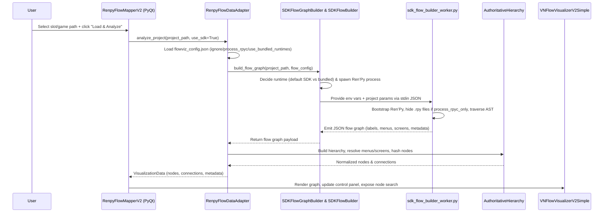

# FlowViz POC – Pipeline Overview

High-level view of the current Flow Visualizer proof of concept so we can plan the slot-based FlowViz rollout inside TPT.

## Layer Stack (bird’s eye)

- **UI Shell (`renpy_flow_visualizer_v2_main.py`, `VNFlowVisualizerV2Simple`, `VNControlPanel`)** – PyQt window where the user browses to a game, toggles SDK mode, and triggers “Load & Analyze”.
- **Flow Data Adapter (`renpy_data_adapter.py`)** – Implements the `FlowDataProvider` interface used by the UI. It loads `flowviz_config.json`, dispatches the SDK pipeline, and translates SDK results into AHS-ready structures.
- **Ren’Py SDK Host (`app/renpy-source-api/sdk_flow_graph_builder.py` + `sdk_flow_builder.py`)** – Orchestrates bootstrap of the embedded Ren’Py 8.4.0 SDK (or an alternative runtime) and requests a flow graph JSON payload.
- **Ren’Py SDK Workers (`sdk_flow_builder_worker.py`, experimental `sdk_flow_builder_worker_py2.py`)** – Run _inside_ the Ren’Py interpreter, walk the AST, extract labels/menus/screens, and emit structured data.
- **Authoritative Hierarchy System (`authoritative_hierarchy.py`)** – Normalizes label/menu relationships, deduplicates helper labels, assigns hashes, and generates the visualization nodes + edges consumed by the UI.

## End-to-End Flow

### Step-by-step

1. **User action** – In `RenpyFlowMapperV2`, the user either types or selects a slot/game path, optionally toggles “Enhanced Analysis (SDK)”, then hits “Load & Analyze”.
2. **Adapter bootstrap** – `RenpyFlowDataAdapter.analyze_project` reads `flowviz_config.json`, resolves helper-label visibility, and records project metadata.
3. **SDK dispatch** – `_build_sdk_flow_graph` calls `SDKFlowGraphBuilder.build_flow_graph`, which instantiates `SDKFlowBuilder`. The host code prepares environment variables (project path, `process_rpyc_only`, `force_rpyc_files`, etc.) and launches the Ren’Py interpreter located under `app/renpy-source-api/renpy_sdk/` unless a bundled runtime override is requested.
4. **Worker execution** – Inside the spawned interpreter, `sdk_flow_builder_worker.py` loads the game, optionally renames `.rpy` files when `process_rpyc_only` is set, walks the AST using Ren’Py’s internal APIs, and serializes Label/Menu/Screen structures into JSON.
5. **Hierarchy build** – Back in the adapter, the returned flow graph is fed into the Authoritative Hierarchy System. AHS deduplicates helper labels, maintains nested menu relationships, attaches menu choices to their parent labels, and produces a uniform list of visualization nodes and edges.
6. **Visualization** – `VisualizationData` is passed back to the PyQt widgets. `VNFlowVisualizerV2Simple` draws the nodes/edges with coloring, while `VNControlPanel` offers search, filtering, and node details.
7. **Metadata** – Totals (label count, menu count, source path, dynamic edge count) are stored for future display and logging.

## Alternate Path: Use Bundled Runtime

When `flowviz_config.json` sets `use_bundled_runtimes = true`, the host layer tries to execute the game with the exact Python + Ren’Py binaries that ship inside the game directory:

- `runtime_locator.py` scans sibling `lib/` and `renpy/` folders for Windows runtimes, preferring `windows-x86_64` and Python 3 builds when available.
- If a suitable interpreter is found, `sdk_flow_builder.py` switches to the corresponding worker script (`sdk_flow_builder_worker.py` for Py3, experimental `sdk_flow_builder_worker_py2.py` for Py2) and exports runtime paths via `FLOW_BUNDLED_RENPY_BASE`, `FLOW_PYTHON_STDLIB`, etc.
- Debug messages indicate whether the system is “Trying bundled runtimes” or “Falling back to default SDK.”
- If bundled launch fails (missing modules, incompatible Ren’Py command set), the host automatically falls back to the embedded 8.4.0 SDK, so the user still gets results.

This branch is key for older games whose `.rpyc` files contain Python 2.7-only syntax, because it lets us bypass Python 3 parsing altogether.

## Appendix – Bundled Runtime Effort & Roadblocks

- **Status** – The Python 3 worker runs end-to-end with bundled runtimes (e.g., Ren’Py 8.x games). The Python 2.7 worker exists (`sdk_flow_builder_worker_py2.py`) but is incomplete; menu hierarchies and screens are still missing because the analyzer logic hasn’t been fully ported.
- **Resolved blockers**
  - Vendored a minimal `Path` shim to avoid `pathlib2` dependency inside Python 2 runtimes.
  - Removed Python 3 type hints from shared utilities so they can be imported by Python 2.7.
  - Added missing APIs (`path_to_common`, `path_to_saves`, etc.) expected by Ren’Py 7.x bootstrap.
  - Ensured `.rpy` files are temporarily hidden when `process_rpyc_only` is true, preventing syntax errors in Python 2 scripts.
- **Outstanding issues**
  - Full analyzer parity (Label/Screen extraction, nested menus, menu-choice destinations) is still not implemented in the Py2 worker, resulting in orphan labels and empty screen nodes.
  - Need durable strategy for shipping or generating the Py2 worker without duplicating most of the Py3 codebase (shared module must stay Py2-safe).
  - Broader test coverage on representative Ren’Py 7.x titles to validate AST parity once the analyzer is ported.

Use this overview to inform the new slot-based architecture: the caching layer will sit between the “Worker emits JSON” step and the “AHS builds visualization” step, storing AST metadata so the UI and other features can consume it without re-running the SDK for every view refresh.
