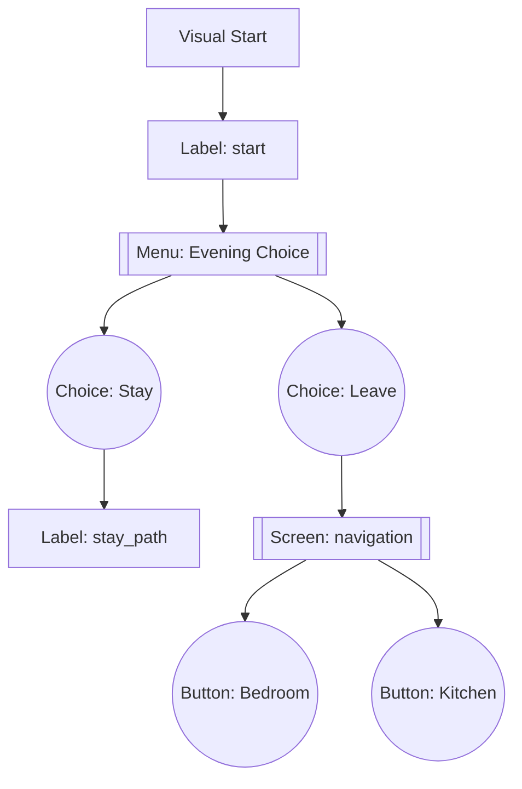

# FlowViz UI – Node & Layout Reference

High-level reference for replicating the Flow Visualizer POC UI inside the main TPT FlowViz feature. Focus on how nodes map to Ren'Py concepts, how edges are rendered, and which layout rules keep the narrative graph readable for story-heavy projects.

## Visual Start Node

- **Purpose**: Purely visual anchor that guarantees we always have a single top-level origin even if the SDK payload fails to return a valid entry label. Treat it as a placeholder and never bind story logic to it.
- **Captioning**: Always render the label text as `Visual Start`. Do not show underlying IDs.
- **Connections**: A single outgoing edge to the actual `start` label (or the first resolvable label). No incoming edges. If the underlying label fails to load, keep the start node visible alone so the user knows something broke upstream.
- **Placement**: Center-top of the canvas. Any auto-layout pass should treat this as fixed before positioning other layers.
- **Styling**: Retain the existing green pill/rectangle for instant recognition. Expose tooltip explaining it is a placeholder to guard against failed node loading.

## Label Nodes

- **Semantics**: Represent Ren’Py `label` definitions detected via the SDK flow graph. Include metadata such as file path, line range, hash, and whether they have dialogue.
- **Role in hierarchy**: Primary parents for menus, screen triggers, jumps, calls, and fallthroughs.
- **Visuals**: Medium-sized rectangles (default blue) with the label name as the title. Entry labels (the SDK-reported start) can reuse the lighter green accent to emphasize they feed directly from the Visual Start node.
- **Behavior**: Selectable/movable but constrained by layout. Tooltips show ID, file, and path. When label loading fails, keep a placeholder node with clear warning text so designers understand the cache is stale.

## Menus & Menu Choices

- **Menu containers**:

  - One container per `menu` block, colored yellow/orange, captioned with the menu prompt and the number of options (`Prompt (N options)`).
  - Exactly one incoming visible edge from the parent label (or from a choice when the menu is nested under another choice).
  - No outgoing edges; instead, the choices are visually nested within the container.
  - Dragging the container moves all contained choices; they are not independently positioned.

- **Menu choices**:
  - Rendered as “buttons” stacked inside the container. Each choice can connect to labels, nested menus, screens, or implicit fallthrough.
  - Use purple or red edges (matching the POC) for narrative flows that exit the menu.
  - Nested menu links: when a choice contains another `menu`, draw a visible edge from the choice to the nested container placed on the tier below.
  - Nested labels defined inside a choice should be styled with a prefix (e.g., `↳ label_name`) and treated as children of the choice, not the parent label.

## Screens & Screen Action Buttons

- **Screen containers**:

  - Created for each `screen` definition captured by the SDK analyzer. Lavender background distinguishes them from menus.
  - Metadata includes the Ren’Py screen name, file/line, and total interactive elements.
  - No incoming edges unless a label or menu choice explicitly `call screen` or `show screen`.

- **Screen action buttons / elements**:
  - Render as child rows (similar to menu choices) inside the screen container. These represent `button`, `imagebutton`, or other actionable widgets that route back into labels or screens.
  - Outgoing edges use the same narrative color palette (red for story jumps, yellow for UI loops) so downstream navigation remains obvious.
  - For non-interactive elements, omit edges but keep them listed to explain why a screen appears empty of actions.

## Edges & Line Styles

- **Primary narrative edges**: Solid red Bezier curves flowing downward from parent labels/choices to their destinations. Arrowheads emphasize direction.
- **Menu relationships**: Yellow edges from labels to menu containers; internal container→choice relations stay invisible (visual containment handles that).
- **Return/Call flows**: Use dotted or dashed lines (matching `VisualizationConnection.line_style`) for `return`, `call`, or helper flows so they are distinguishable without overpowering main paths.
- **Screen triggers**: Light blue or purple edges from labels/choices to screen containers to differentiate UI branching from pure narrative branching.
- **Edge updates**: Whenever nodes move (manual drag or automated layout), recompute Bezier anchor points to keep curves smooth and arrowheads aligned.

## Layout Principles

### Vertical, Dot-Like Hierarchy

- Use the dot-like layout already implemented in `vn_flow_visualizer.py` as the reference. It performs a layered topological ordering (similar to Graphviz DOT) and assigns y-levels that naturally flow downward.
- **Top row**: Visual Start plus any true orphan labels (no incoming edges). Keep orphans horizontally aligned with Visual Start so they remain visible even when unconnected.
- **Subsequent rows**: Each row represents the next reachable tier of nodes (labels → menus → choices → nested menus/screens). Maintain strict parent-before-child ordering.
- **Spacing**: Vertical spacing should prioritize readability over compactness; users scan top-to-bottom, so allow generous gaps between rows to avoid edge overlaps.

### SCC / High-Connectivity Layout

- Dense strongly connected components (SCCs), such as free-roam hubs, momentarily switch to a circular micro-layout so edges do not overlap excessively.
- After the SCC cluster, the output nodes rejoin the vertical stack at the appropriate tier. Ensure transitions back to the dot-like rows remain smooth (outgoing edges drop down to the next vertical layer).
- Keep SCC circles compact and centered around the average x-position of their parent layer to avoid jarring lateral jumps.

### Orphan Handling

- Real orphans (labels with no inbound edges) should stay on the Visual Start row to keep them in sight. Apply a subtle warning color or tooltip to encourage authors to wire them up.
- False orphans (labels that only receive flows via helper constructs) should be filtered out before layout, just like the POC’s `_filter_false_orphans` does, to avoid clutter.
- Even when orphan count is large, strive for a grid that still trends downward—avoid placing orphans below the main story unless explicitly requested.

## Layout Algorithm Reference

- **Default algorithm**: `dot_like` (single option in the production visualizer). It performs layer assignment, crossing minimization, and coordinate assignment similar to Graphviz’ Sugiyama method.
- **SCC awareness**: During layout, detect subgraphs with high mutual connectivity and temporarily switch those nodes to circular positioning while keeping inbound/outbound anchors aligned with the vertical tiers.
- **Update cycle**: After computing positions, refresh all Bezier edges, then call `fit_view_to_content` so the user lands on a full-graph view.
- **Manual adjustments**: Users can drag nodes; connections update live. Provide a “Reset Layout” action that re-runs the dot-like placement to restore the canonical vertical flow.

## Design Guidance for Agentic Tools

- Always design around vertical storytelling: start at the top, choices fan downward, screens branch sideways but still trend down.
- Preserve literal text “Visual Start” at the top to maintain parity with the POC and to serve as a sanity check when new caches fail to emit nodes.
- Containers (menus/screens) act like grouped cards; nested elements ride inside them, so tooling should keep child nodes visually bound.
- When in doubt, favor clarity over raw density. The FlowViz UI is meant for story analysis, not compact graph theory renderings—empty space is acceptable if it keeps the narrative legible.

Use this document when coordinating with Figma’s Make or another GPT agent so every redesign remains faithful to the original Flow Visualizer semantics while preparing for the slot-based cache workflow.
