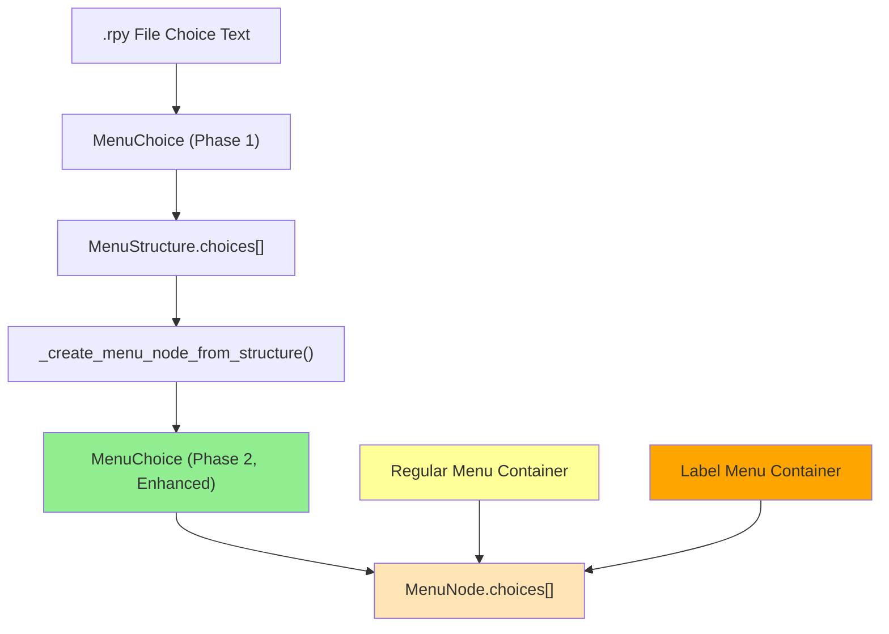

# Choice Objects Architecture - Regular vs Label Menus

## 📋 **Overview**

This document explains how choice objects are handled in the Flow Visualizer POC, specifically addressing whether regular menus and label menus use the same choice objects.

**Answer**: ✅ **Yes, both regular menus and label menus contain exactly the same choice objects.**

**Last Updated**: August 2025  
**Based on**: Technical analysis of `app/renpy-source-api/parser.py` and related modules

---

## 🏗️ **Shared Choice Processing Pipeline**

### **No Conditional Logic for Menu Types**

**File**: `app/renpy-source-api/parser.py` (Lines 782-797)

```python
# In _create_menu_node_from_structure() - SAME for both menu types
for i, choice in enumerate(menu_structure.choices):
    enhanced_choice = MenuChoice(  # ← Same MenuChoice class for both
        text=choice.text,
        condition=choice.condition,
        destination=choice.destination,
        action_type=choice.action_type,
        file_path=choice.file_path,
        line_number=choice.line_number,
        subsequent_lines=choice.subsequent_lines,
        nested_labels=choice.nested_labels,
        choice_index=i
    )

    # Analyze choice for metadata - SAME enhancement for both
    self._enhance_choice_metadata(enhanced_choice)
    enhanced_choices.append(enhanced_choice)
```

**Critical Insight**: The choice processing loop contains **no conditional logic** that differentiates between regular menus (`menu:`) and label menus (`menu label_name:`). Both types go through the identical conversion process.

---

## 📊 **Two-Phase Choice Architecture**

### **Phase 1: Initial Parsing** - Raw Choice Detection

**File**: `app/renpy-source-api/control_flow/analyze_vn_menus.py` (Lines 45-60)

```python
@dataclass
class MenuChoice:
    """Represents a single menu choice during initial parsing."""
    text: str
    condition: Optional[str] = None  # if clause condition
    destination: Optional[str] = None  # jump/call target
    action_type: Optional[str] = None  # 'jump', 'call', 'return', 'pass'
    file_path: str = ""
    line_number: int = 0
    has_variables: bool = False  # Contains $ statements
    has_jumps: bool = False
    has_calls: bool = False
    nested_menu: bool = False  # Contains another menu
    nested_labels: List[str] = field(default_factory=list)
    nested_menu_structures: List['MenuStructure'] = field(default_factory=list)
    subsequent_lines: List[str] = field(default_factory=list)
```

**Purpose**: Initial detection and basic parsing of choice structures from `.rpy` files.

### **Phase 2: Enhanced Flow Graph** - Rich Metadata

**File**: `app/renpy-source-api/parser.py` (Lines 45-69)

```python
@dataclass
class MenuChoice:
    """Represents a choice within a menu with enhanced metadata."""
    # Core choice data (same as Phase 1)
    text: str
    condition: Optional[str] = None
    destination: Optional[str] = None
    action_type: Optional[str] = None
    file_path: str = ""
    line_number: int = 0
    subsequent_lines: List[str] = field(default_factory=list)
    nested_labels: List[str] = field(default_factory=list)

    # Enhanced metadata for app consumption
    choice_index: int = 0  # Order within the menu (0-based)
    has_condition: bool = False  # Computed from condition field
    leads_to_label: bool = False  # True if destination is a label
    leads_to_return: bool = False  # True if action_type is return
    contains_media_references: List[str] = field(default_factory=list)
    contains_variable_changes: List[str] = field(default_factory=list)
    estimated_story_impact: str = "unknown"  # "major", "minor", "cosmetic"
```

**Purpose**: Enhanced choice objects with rich metadata for flow analysis and visualization.

---

## 🎯 **Where Menu Types Differ**

The distinction between regular menus and label menus affects **only the container**, never the choices:

### **Container-Level Differences**

**File**: `app/renpy-source-api/parser.py` (Lines 770-776)

```python
# In _create_menu_node_from_structure()
if menu_structure.label_name:
    # Label menu - use actual label name
    node_id = menu_structure.label_name  # ← "day02_p_room_choices"
else:
    # Regular menu - use generic naming
    node_id = f"{parent_label}_menu_{menu_index + 1}"  # ← "scene1_menu_1"
```

### **MenuNode Creation** (Lines 824-837)

```python
menu_node = MenuNode(
    node_id=node_id,  # ← DIFFERENT: Based on menu type
    name="",
    parent_label=parent_label,
    menu_index=menu_index,
    label_name=menu_structure.label_name,  # ← KEY DIFFERENCE: None vs "label_name"
    file_path=menu_structure.file_path,
    line_number=menu_structure.line_number,
    choices=enhanced_choices,  # ← IDENTICAL: Same choices for both types
    menu_type=menu_type,
    is_nested=menu_structure.nesting_level > 0 and not menu_structure.label_name,
    nesting_level=menu_structure.nesting_level,
    # ... rest of fields
)
```

---

## 📋 **Comparison Table**

| Aspect                     | Regular Menu (`menu:`)                   | Label Menu (`menu label_name:`)          |
| -------------------------- | ---------------------------------------- | ---------------------------------------- |
| **Choice Objects**         | ✅ **Same `MenuChoice` class**           | ✅ **Same `MenuChoice` class**           |
| **Choice Processing**      | ✅ **Same conversion logic**             | ✅ **Same conversion logic**             |
| **Choice Enhancement**     | ✅ **Same `_enhance_choice_metadata()`** | ✅ **Same `_enhance_choice_metadata()`** |
| **Choice Fields**          | ✅ **All fields available**              | ✅ **All fields available**              |
| **Container Node ID**      | `{parent}_menu_{index}`                  | `{label_name}`                           |
| **Container Color**        | Yellow                                   | Orange                                   |
| **Container `label_name`** | `None`                                   | `"actual_label_name"`                    |
| **Flow Graph Entry**       | Part of parent label                     | **Separate LabelNode**                   |

---

## 🔄 **Choice Data Flow**



**Key Point**: The choice enhancement process (D→E) is **identical** regardless of container type (G vs H).

---

## 🧪 **Technical Verification**

### **Code to Verify Identical Choice Processing**

```python
def verify_choice_consistency(flow_graph: Dict[str, Any]):
    """Verify that choices are processed identically for both menu types."""

    regular_menu_choices = []
    label_menu_choices = []

    for label_name, label_node in flow_graph.items():
        for menu_node in label_node.menu_nodes:
            for choice in menu_node.choices:
                # Collect choice properties
                choice_data = {
                    'text': choice.text,
                    'condition': choice.condition,
                    'destination': choice.destination,
                    'action_type': choice.action_type,
                    'has_condition': choice.has_condition,
                    'leads_to_label': choice.leads_to_label,
                    'choice_index': choice.choice_index,
                    'class_type': type(choice).__name__
                }

                if menu_node.label_name:  # Label menu
                    label_menu_choices.append(choice_data)
                else:  # Regular menu
                    regular_menu_choices.append(choice_data)

    # Verify both use same class and have same available fields
    if regular_menu_choices and label_menu_choices:
        regular_fields = set(regular_menu_choices[0].keys())
        label_fields = set(label_menu_choices[0].keys())

        print(f"Regular menu choice fields: {regular_fields}")
        print(f"Label menu choice fields: {label_fields}")
        print(f"Fields identical: {regular_fields == label_fields}")
        print(f"Both use MenuChoice class: {regular_menu_choices[0]['class_type'] == label_menu_choices[0]['class_type']}")
```

### **Expected Output**

```
Regular menu choice fields: {'text', 'condition', 'destination', 'action_type', 'has_condition', 'leads_to_label', 'choice_index', 'class_type'}
Label menu choice fields: {'text', 'condition', 'destination', 'action_type', 'has_condition', 'leads_to_label', 'choice_index', 'class_type'}
Fields identical: True
Both use MenuChoice class: True
```

---

## 🔍 **Choice Enhancement Process**

### **Shared Enhancement Logic**

**File**: `app/renpy-source-api/parser.py` (Lines 890-930)

```python
def _enhance_choice_metadata(self, choice: MenuChoice) -> None:
    """
    Add enhanced metadata to a choice object.

    This method is called for ALL choices regardless of menu type.
    """
    # Analyze choice destination
    if choice.destination:
        choice.leads_to_label = choice.action_type in ['jump', 'call']
        choice.leads_to_return = choice.action_type == 'return'

    # Analyze subsequent lines for media references
    for line in choice.subsequent_lines:
        # Extract asset references, variable changes, etc.
        if 'scene' in line or 'show' in line:
            choice.contains_media_references.append(line.strip())
        if '$' in line:
            choice.contains_variable_changes.append(line.strip())

    # Estimate story impact based on destination and content
    if choice.destination and choice.leads_to_label:
        choice.estimated_story_impact = "major"
    elif choice.contains_variable_changes:
        choice.estimated_story_impact = "minor"
    else:
        choice.estimated_story_impact = "cosmetic"
```

**Key Point**: This enhancement runs identically for choices in both regular menus and label menus.

---

## ⚠️ **Architectural Implications**

### **1. Choice Consistency**

- ✅ All choice-related code can assume consistent MenuChoice structure
- ✅ No need for menu-type-specific choice handling
- ✅ Choice validation and analysis works uniformly

### **2. Visualization Layer**

```python
# In ideas-lab/flow-visualizer-poc/renpy_data_adapter.py
def _create_choice_buttons_and_connections(self, menu_node, container_id: str,
                                          label_name: str, container_nodes: List,
                                          choice_connections: List):
    """Create choice buttons - SAME for both menu types."""

    for choice_idx, choice in enumerate(menu_node.choices):  # ← Same MenuChoice objects
        choice_button = VisualizationNode(
            node_id=f"{container_id}_choice_{choice_idx}",
            node_type='choice_button',
            display_name=choice.text,  # ← Same .text field
            metadata={
                'parent_container': container_id,
                'choice_index': choice_idx,
                'condition': choice.condition,  # ← Same .condition field
                'destination': choice.destination,  # ← Same .destination field
                'action_type': choice.action_type  # ← Same .action_type field
            }
        )
        container_nodes.append(choice_button)
```

### **3. Flow Analysis**

```python
# Choice analysis works identically for both menu types
for menu_node in label_node.menu_nodes:
    for choice in menu_node.choices:
        # All these properties available regardless of menu type:
        print(f"Choice: {choice.text}")
        print(f"Goes to: {choice.destination}")
        print(f"Has condition: {choice.has_condition}")
        print(f"Story impact: {choice.estimated_story_impact}")
```

---

## 📚 **Related Documentation**

- **[NODE_TYPES_REFERENCE.md](./NODE_TYPES_REFERENCE.md)**: Complete node type overview including label menu distinction
- **Parser Implementation**: `app/renpy-source-api/parser.py` (Lines 782-797, 890-930)
- **Menu Analysis**: `app/renpy-source-api/control_flow/analyze_vn_menus.py` (Lines 45-60)
- **Choice Processing**: `_create_menu_node_from_structure()` and `_enhance_choice_metadata()`

---

## 🎯 **Summary**

**The choice objects are completely identical between regular menus and label menus.** The architectural distinction lies entirely at the **container level**:

- **Regular Menu Container**: `{parent}_menu_{index}`, yellow, `label_name = None`
- **Label Menu Container**: `{actual_label_name}`, orange, `label_name = "actual_name"`
- **Choice Objects**: Identical `MenuChoice` class, same fields, same processing pipeline

This design ensures **consistency** and **simplicity** - all choice-related functionality works uniformly regardless of menu type, while the container-level distinction provides the necessary architectural differentiation for flow graphs and visualization.
