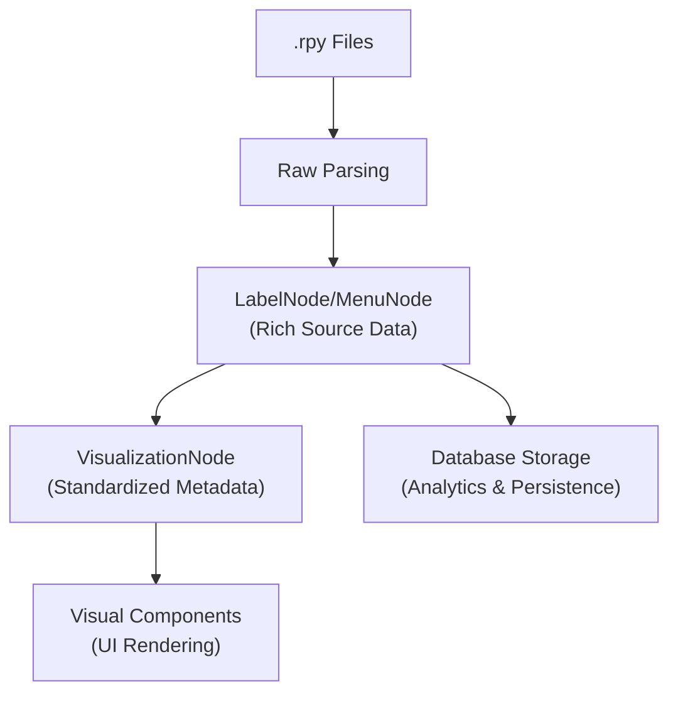

# Node Metadata Reference - Flow Visualizer POC

## 📋 **Overview**

This document provides a comprehensive reference for all metadata stored about each node type in the Flow Visualizer POC, covering both in-memory structures and persistent database storage.

**Key Finding**: The system stores **extensive metadata** across multiple layers, from basic identification to advanced analytics and visualization hints.

**Last Updated**: August 2025  
**Based on**: Analysis of `flow_visualizer_interface.py`, `renpy_data_adapter.py`, and database schemas

---

## 🏗️ **Metadata Storage Architecture**

### **Multi-Layer Metadata System**

```
┌─────────────────────┐
│   Database Layer    │ ← Persistent storage with analytics
├─────────────────────┤
│  VisualizationNode  │ ← Standardized in-memory structure
├─────────────────────┤
│  Source Data Layer  │ ← Raw parsed data (LabelNode, MenuNode)
└─────────────────────┘
```

### **Core Metadata Structure**

**Base Class**: `VisualizationNode` in `flow_visualizer_interface.py`

```python
@dataclass
class VisualizationNode:
    # Core identification
    node_id: str                        # Unique identifier
    node_type: str                      # 'label', 'menu_container', 'choice_button', 'start'
    display_name: str                   # Human-readable name

    # Visual hints
    suggested_position: Optional[tuple] # (x, y) position hint
    color_hint: Optional[str]          # Color for rendering
    size_hint: Optional[tuple]         # (width, height) for UI

    # Rich metadata dictionary
    metadata: Dict[str, Any]           # Node-type-specific metadata

    # Connectivity
    incoming_connections: List[str]    # IDs of incoming nodes
    outgoing_connections: List[str]    # IDs of outgoing nodes
```

---

## 📊 **Metadata by Node Type**

### **1. Label Nodes (`node_type='label'`)**

#### **In-Memory Metadata** (`VisualizationNode.metadata`)

**Source**: `renpy_data_adapter.py` (Lines 219-229)

```python
metadata = {
    # Source location
    'file_path': str,                  # Path to .rpy file
    'line_number': int,               # Line number in file

    # Content analysis
    'has_dialogue': bool,             # Contains dialogue lines
    'is_reachable': bool,            # Can be reached from start
    'is_dead_end': bool,             # No outgoing flows
    'flow_complexity': int,          # Number of possible paths

    # Semantic classification
    'semantic_type': str,            # 'entry_point', 'ending', 'hub', 'regular'

    # Flow analysis
    'incoming_count': int,           # Number of incoming connections
    'outgoing_count': int            # Number of outgoing connections
}
```

#### **Source Data Metadata** (`LabelNode` class)

**Source**: `app/renpy-source-api/parser.py` (Lines 201-236)

```python
@dataclass
class LabelNode:
    name: str                                    # Label name
    file_path: str                              # Source file
    line_number: int                            # Source line
    incoming_flows: List[LabelFlow]             # Incoming flow objects
    outgoing_flows: List[LabelFlow]             # Outgoing flow objects
    has_menu: bool                              # Contains menus
    has_dialogue: bool                          # Contains dialogue
    is_reachable: bool                          # Reachable from start
    is_dead_end: bool                           # Terminal node
    flow_complexity: int                        # Path complexity
    menu_structures: List[MenuStructure]        # Raw menu data
    menu_nodes: List[MenuNode]                  # Enhanced menu objects
    menu_count: int                             # Number of menus
```

#### **Database Storage** (`RenpyAPILabel` table)

**Source**: `app/renpy-source-api/database.py` (Lines 287-327)

```python
class RenpyAPILabel:
    id: int                           # Primary key
    created_at: datetime              # Creation timestamp
    label_name: str                   # Label identifier
    file_path: str                    # Source file path
    line_number: int                  # Source line number
    total_flows_in: int              # Incoming flow count
    total_flows_out: int             # Outgoing flow count
    is_reachable: bool               # Reachability flag
    depth_from_start: int            # Distance from start node
    scene_type: str                  # 'hub', 'bridge', 'endpoint'
    narrative_importance: float      # Calculated importance score
    project_id: int                  # Foreign key to project
```

---

### **2. Menu Container Nodes (`node_type='menu_container'`)**

#### **In-Memory Metadata** (`VisualizationNode.metadata`)

**Source**: `renpy_data_adapter.py` (Lines 455-468)

```python
metadata = {
    # Hierarchy
    'parent_label': str,              # Parent label name
    'menu_index': int,               # Index within parent label

    # Menu analysis
    'complexity_level': str,         # 'simple', 'moderate', 'complex', 'expert'
    'total_choices': int,           # Number of choice buttons
    'prompt': str,                  # Menu question/prompt text
    'menu_type': str,               # 'standard', 'conditional', 'nested'
    'has_conditions': bool,         # Contains conditional choices
    'story_significance': str,      # 'critical', 'major', 'minor', 'cosmetic'

    # Structure
    'is_nested': bool,              # Whether this is a nested menu
    'nesting_level': int,           # Depth of nesting
    'is_label_menu': bool,          # True for label menus (orange)
    'label_name': Optional[str]     # Original label name for label menus
}
```

#### **Source Data Metadata** (`MenuNode` class)

**Source**: `app/renpy-source-api/parser.py` (Lines 73-146)

```python
@dataclass
class MenuNode:
    # Core identification
    node_id: str                               # Unique menu identifier
    name: str                                  # Descriptive name
    parent_label: str                          # Containing label
    menu_index: int                           # Index within label
    label_name: Optional[str]                 # For label menus

    # Source location
    file_path: str                            # Source .rpy file
    line_number: int                          # Source line

    # Content structure
    prompt: Optional[str]                     # Menu prompt text
    choices: List[MenuChoice]                 # Choice objects
    total_choices: int                        # Choice count

    # Analysis metadata
    menu_type: str                           # 'standard', 'conditional', 'nested'
    complexity_level: str                    # Computed complexity
    branching_factor: int                    # Unique destinations
    has_conditions: bool                     # Contains conditionals
    has_menu_set: bool                       # Uses menu sets
    menu_set_variable: Optional[str]         # Menu set variable

    # Hierarchy
    is_nested: bool                          # Nested flag
    nesting_level: int                       # Nesting depth
    parent_menu_id: Optional[str]            # Parent menu ID
    nested_menu_ids: List[str]               # Child menu IDs

    # Story analysis
    story_significance: str                  # Story importance
    choice_destinations: List[str]           # All destinations
    creates_branches: bool                   # Branching flag
    can_create_loops: bool                   # Loop potential

    # Media and assets
    referenced_assets: List[str]             # Asset references
    asset_categories: List[str]              # Asset types

    # Performance metadata
    estimated_play_time: int                 # Estimated read time (seconds)
    choice_complexity_scores: List[float]    # Per-choice complexity
```

#### **Database Storage** (`RenpyAPIMenu` table)

**Source**: `app/renpy-source-api/database.py` (Lines 227-255)

```python
class RenpyAPIMenu:
    id: int                          # Primary key
    created_at: datetime             # Creation timestamp
    file_path: str                   # Source file path
    line_number: int                 # Source line number
    label_context: str               # Containing label
    menu_text: str                   # Menu prompt text
    total_choices: int               # Number of choices
    complexity_score: float          # Computed complexity
    branching_factor: int            # Unique destinations
    project_id: int                  # Foreign key to project
```

---

### **3. Choice Button Nodes (`node_type='choice_button'`)**

#### **In-Memory Metadata** (`VisualizationNode.metadata`)

**Source**: `renpy_data_adapter.py` (Lines 832-843)

```python
metadata = {
    # Hierarchy
    'parent_container': str,          # Parent menu container ID
    'choice_index': int,             # Index within menu

    # Choice content
    'full_text': str,                # Complete choice text (untruncated)
    'condition': Optional[str],      # Conditional expression
    'destination': Optional[str],    # Jump/call target
    'action_type': str,              # 'jump', 'call', 'return', 'pass'
    'has_condition': bool,           # Conditional flag

    # Analysis
    'estimated_story_impact': str,   # 'major', 'minor', 'cosmetic'
    'contains_media_references': List[str],    # Asset references
    'contains_variable_changes': List[str]     # Variable modifications
}
```

#### **Source Data Metadata** (`MenuChoice` class)

**Source**: `app/renpy-source-api/parser.py` (Lines 45-69)

```python
@dataclass
class MenuChoice:
    # Core content
    text: str                               # Choice display text
    condition: Optional[str]                # Conditional expression
    destination: Optional[str]              # Target label
    action_type: Optional[str]             # Action type
    file_path: str                         # Source file
    line_number: int                       # Source line
    subsequent_lines: List[str]            # Following code lines
    nested_labels: List[str]               # Nested label definitions

    # Enhanced analysis
    choice_index: int                      # Order within menu
    has_condition: bool                    # Conditional flag
    leads_to_label: bool                   # Target is label
    leads_to_return: bool                  # Returns from call
    contains_media_references: List[str]   # Media assets
    contains_variable_changes: List[str]   # Variable modifications
    estimated_story_impact: str           # Impact assessment
```

#### **Database Storage** (`RenpyAPIChoice` table)

**Source**: `app/renpy-source-api/database.py` (Lines 258-284)

```python
class RenpyAPIChoice:
    id: int                          # Primary key
    created_at: datetime             # Creation timestamp
    choice_text: str                 # Choice display text
    choice_condition: str            # Conditional expression
    destination_type: str            # 'jump', 'call', 'expression'
    destination_target: str          # Target identifier
    popularity_score: float          # Usage analytics
    choice_order: int                # Order within menu
    menu_id: int                     # Foreign key to menu
    project_id: int                  # Foreign key to project
```

---

### **4. Visual Start Node (`node_type='start'`)**

#### **In-Memory Metadata** (`VisualizationNode.metadata`)

**Source**: `renpy_data_adapter.py` (Lines 993-997)

```python
metadata = {
    'is_visual_node': True,           # Flag for visual-only node
    'represents_entry_point': str,    # Actual entry point label name
    'semantic_type': 'visual_start',  # Semantic classification
    'description': str                # Human description
}
```

**Note**: Visual start nodes are **not stored in the database** as they are synthetic visualization elements.

---

## 🔄 **Metadata Flow and Transformation**

### **Data Flow Pipeline**



### **Metadata Transformation Example**

```python
# Source data (MenuNode)
menu_node = MenuNode(
    complexity_level="complex",
    total_choices=5,
    has_conditions=True,
    story_significance="critical",
    # ... 20+ additional fields
)

# Transformed to visualization metadata
visualization_metadata = {
    'complexity_level': menu_node.complexity_level,    # Preserved
    'total_choices': menu_node.total_choices,         # Preserved
    'has_conditions': menu_node.has_conditions,       # Preserved
    'story_significance': menu_node.story_significance, # Preserved
    'parent_label': label_name,                       # Added context
    'is_label_menu': bool(menu_node.label_name)       # Computed flag
}

# Stored in database (simplified)
database_record = RenpyAPIMenu(
    total_choices=menu_node.total_choices,            # Preserved
    complexity_score=complexity_to_float(menu_node.complexity_level), # Computed
    branching_factor=len(menu_node.choice_destinations) # Computed
)
```

---

## 📈 **Metadata Categories and Usage**

### **Identification Metadata**

- **Purpose**: Unique identification and source tracking
- **Examples**: `node_id`, `file_path`, `line_number`, `parent_label`
- **Usage**: Node lookup, debugging, source navigation

### **Structure Metadata**

- **Purpose**: Hierarchical relationships and organization
- **Examples**: `menu_index`, `choice_index`, `nesting_level`, `parent_container`, `parent_choice`
- **Usage**: Layout algorithms, hierarchy visualization

### **Nested Menu Fields**

When a `menu_container` is nested under a choice, the following metadata MUST be present on that container's `VisualizationNode.metadata`:

#### **Authoritative Hierarchy Fields (Current System)**

- `parent_choice`: str — **Content hash** of the parent `choice` node (e.g., `"9x8y7z6w"`)

  - **Source**: `parent_choice.content_hash` from `HierarchyNode.parent` relationship
  - **Usage**: `parent_choice = hierarchy.get_node(metadata['parent_choice'])` (O(1) lookup)
  - **Stability**: Content-based, immune to index changes

- `nesting_level`: int — 0 for top-level menus (children of labels), >0 for nested levels

  - **Source**: Direct from `MenuStructure.nesting_level` via authoritative hierarchy
  - **Usage**: Layout algorithms use this for positioning and visual hierarchy

- `is_nested`: bool — `True` for nested menu containers
  - **Source**: Derived from `nesting_level > 0` and hierarchy structure
  - **Usage**: Quick nested menu identification

#### **Legacy Fields (Transitional)**

- `parent_choice_id`: str — Same as `parent_choice` but maintains old field name

  - **Status**: ⚠️ **Transitional** - Use `parent_choice` or direct hierarchy relationships instead

- `parent_container`: str — String-based parent container ID
  - **Status**: ⚠️ **Legacy** - Authoritative hierarchy provides direct object relationships instead
  - **Note**: May still be present during dual-system transition

#### **Capabilities Enabled**

- Visible edges from `choice_button` → nested `menu_container`
- Correct tier placement in the dot-like layout
- Accurate traversal of `label → container → choice → container → …`

### **Content Metadata**

- **Purpose**: Semantic content and meaning
- **Examples**: `has_dialogue`, `prompt`, `choice_text`, `condition`
- **Usage**: Search, filtering, content analysis

### **Analysis Metadata**

- **Purpose**: Computed insights and analytics
- **Examples**: `complexity_level`, `story_significance`, `estimated_story_impact`
- **Usage**: Visualization hints, importance ranking, analytics

### **Visual Metadata**

- **Purpose**: Rendering and UI hints
- **Examples**: `color_hint`, `size_hint`, `semantic_type`
- **Usage**: Visual styling, layout decisions, theming

### **Performance Metadata**

- **Purpose**: Optimization and caching
- **Examples**: `estimated_play_time`, `popularity_score`, `depth_from_start`
- **Usage**: Performance optimization, user experience analytics

---

## 💾 **Storage Strategies**

### **In-Memory Storage** (`VisualizationNode.metadata`)

- **Scope**: Current visualization session
- **Performance**: Fast access for UI operations
- **Content**: Visualization-specific metadata
- **Lifetime**: Session-based, cleared on reload

### **Database Storage** (`RenpyAPI*` tables)

- **Scope**: Persistent across sessions
- **Performance**: Optimized for analytics queries
- **Content**: Core metadata + computed analytics
- **Lifetime**: Persistent until project deletion

### **Source Data Storage** (`LabelNode`/`MenuNode`)

- **Scope**: Parsing and conversion phase
- **Performance**: Rich object model for complex operations
- **Content**: Complete parsed metadata
- **Lifetime**: Processing phase only

---

## 🎯 **Metadata Completeness by Node Type**

| Node Type          | Identification | Structure   | Content     | Analysis    | Visual      | Database    |
| ------------------ | -------------- | ----------- | ----------- | ----------- | ----------- | ----------- |
| **Label**          | ✅ Complete    | ✅ Complete | ✅ Complete | ✅ Complete | ✅ Complete | ✅ Complete |
| **Menu Container** | ✅ Complete    | ✅ Complete | ✅ Complete | ✅ Complete | ✅ Complete | ✅ Complete |
| **Choice Button**  | ✅ Complete    | ✅ Complete | ✅ Complete | ✅ Complete | ✅ Complete | ✅ Complete |
| **Visual Start**   | ✅ Complete    | ⚠️ Minimal  | ⚠️ Minimal  | ⚠️ Minimal  | ✅ Complete | ❌ None     |

**Note**: Visual start nodes have minimal metadata as they are synthetic visualization elements.

---

## 📚 **Related Documentation**

- **[NODE_TYPES_REFERENCE.md](./NODE_TYPES_REFERENCE.md)**: Node type specifications
- **[NODE_IDENTIFICATION_STRATEGY.md](./NODE_IDENTIFICATION_STRATEGY.md)**: ID generation strategies
- **Interface Definition**: `ideas-lab/flow-visualizer-poc/flow_visualizer_interface.py`
- **Data Adapter**: `ideas-lab/flow-visualizer-poc/renpy_data_adapter.py`
- **Database Schema**: `app/renpy-source-api/database.py`

---

## 🎯 **Summary**

The Flow Visualizer POC stores **comprehensive metadata** across multiple layers:

1. **Rich Source Data**: 20+ fields per node type in parsing layer
2. **Standardized Visualization**: 8-12 core metadata fields per node type
3. **Persistent Analytics**: 6-10 key metrics in database storage

**Key Strengths**:

- ✅ **Comprehensive coverage** across all node types
- ✅ **Multi-layer architecture** for different use cases
- ✅ **Rich analytical metadata** for advanced features
- ✅ **Visualization-optimized** metadata structure

**Total Metadata Fields**: **40-60 unique metadata fields** per node type when combining all layers, making this a very metadata-rich system capable of supporting advanced analysis and visualization features.
