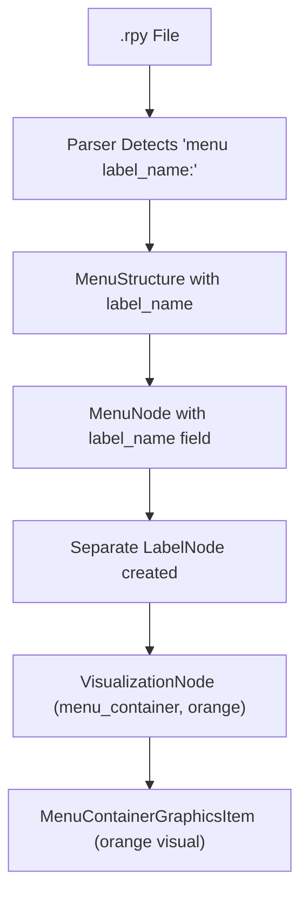

# Flow Visualizer POC - Node Types Reference

## 📋 **Overview**

This document provides a comprehensive reference for all node types produced by the Flow Visualizer POC. Understanding these node types is crucial for working with the visualization system, debugging layout issues, and extending the codebase.

**Last Updated**: August 2025  
**Based on**: Flow Visualizer POC codebase analysis

---

## 🏗️ **Primary Node Types (Main Categories)**

### 1. **`'label'`** - Regular Story Labels

- **Purpose**: Represent story sections, narrative beats, and dialogue scenes
- **Examples**: `start`, `ch1scene1`, `day02`, `conversation_with_mom`, `ending_good`
- **Color**: Varies by semantic sub-type (see Semantic Sub-Types section)
- **Connectivity**:
  - ✅ Can have multiple incoming connections
  - ✅ Can have multiple outgoing connections
  - ✅ Can be parents to other labels and menu containers
  - ❌ **NEVER** directly parent choice buttons (must go through containers)

**Code Creation Example**:

```python
VisualizationNode(
    node_id=label_name,
    node_type='label',
    display_name=label_name,
    color_hint=self._get_color_for_type(semantic_type),
    metadata={
        'file_path': label_node.file_path,
        'line_number': label_node.line_number,
        'has_dialogue': label_node.has_dialogue,
        'semantic_type': semantic_type
    }
)
```

### 2. **`'menu_container'`** - Menu Grouping Nodes

- **Purpose**: Visual containers that group related menu choices together
- **Naming Pattern**: `{label_name}_menu_{index}` (e.g., `start_menu_0`, `day02_menu_1`)
- **Color**: **Yellow** for visual distinction
- **Connectivity Rules**:
  - ✅ **EXACTLY ONE** incoming edge from parent label
  - ✅ **NO outgoing edges** (choices handle the narrative flow)
  - ✅ **MUST contain** all related choice buttons
  - ❌ **NEVER** appear as orphans (always have a parent)

**Code Creation Example**:

```python
VisualizationNode(
    node_id=f"{parent_label}_menu_{menu_idx}",
    node_type='menu_container',
    display_name=f"Menu: {menu_prompt}",
    color_hint='yellow',
    metadata={
        'parent_label': parent_label,
        'total_choices': len(choices),
        'complexity_level': 'simple',
        'prompt': menu_prompt
    }
)
```

### 3. **`'choice_button'`** - Individual Menu Choices

- **Purpose**: Individual selectable options within menus
- **Naming Pattern**: `{container_id}_choice_{index}` (e.g., `start_menu_0_choice_1`)
- **Color**: Based on choice properties and conditions
- **Connectivity Rules**:
  - ✅ **NO incoming edges** (they're "glued" to containers via hierarchy)
  - ✅ Can have outgoing connections to other labels/containers/nested labels
  - ✅ **ALWAYS** belong to a menu container parent
  - ❌ **NEVER** treated as orphans (even if `in_degree == 0`)

### 4. **`'nested_label'`** - Labels Within Choice Blocks

- **Purpose**: Labels defined within menu choice blocks (semantic ownership)
- **Naming Pattern**: `{choice_id}_nested_label_{label_name}#{hash}` (content-based)
- **Color**: **Light Cyan** (`lightcyan`) for visual distinction
- **Display**: `↳ {label_name}` (arrow prefix indicates nesting)
- **Connectivity Rules**:
  - ✅ **EXACTLY ONE** incoming edge from parent choice (purple connection)
  - ✅ Can have outgoing connections to other labels
  - ✅ **Semantic ownership** by specific choice (not parent label)
  - ❌ **NEVER** appear as regular labels in flow graph

**Code Creation Example**:

```python
# Created by AHS when choice.nested_labels detected
nested_label_node = HierarchyNode(
    content_hash=content_hash,
    semantic_id=f"{parent_choice.semantic_id}_nested_label_{label_name}#{hash[:8]}",
    node_type='label',  # Internal type (converted to 'nested_label' for visualization)
    display_name=f"↳ {label_name}",
    content={
        'label_name': label_name,
        'is_nested': True,
        'label_type': 'nested_within_choice',
        'parent_choice_id': parent_choice.content_hash
    }
)
```

**Visualization Conversion**:

```python
# Converted to nested_label for visual rendering
VisualizationNode(
    node_id=hierarchy_node.content_hash,
    node_type='nested_label',
    display_name=hierarchy_node.display_name,  # Already has ↳ prefix
    color_hint='lightcyan',
    size_hint=(120, 40),
    metadata={
        'label_name': label_name,
        'is_nested': True,
        'parent_choice': parent_choice_id
    }
)
```

### 5. **`'__VISUAL_START__'`** - Visual Entry Point

```python
VisualizationNode(
    node_id=f"{container_id}_choice_{choice_idx}",
    node_type='choice_button',
    display_name=choice_text,
    metadata={
        'parent_container': container_id,
        'choice_index': choice_idx,
        'condition': choice_condition,
        'destination': target_label,
        'action_type': 'jump'
    }
)
```

### 4. **`'start'`** - Special Visual Start Node

- **Purpose**: Visual anchor point for the entire narrative flow
- **Node ID**: `"__VISUAL_START__"` (special reserved identifier)
- **Color**: **Green**
- **Connectivity Rules**:
  - ✅ Always orphaned by definition (no incoming edges)
  - ✅ Connects ONLY to the actual SDK-detected entry point
  - ✅ Always positioned at the top level of visualization
  - ✅ Exactly one instance per visualization

**Code Creation Example**:

```python
VisualizationNode(
    node_id="__VISUAL_START__",
    node_type='start',
    display_name="Start",
    color_hint='green',
    size_hint=(100, 50),
    metadata={
        'is_visual_node': True,
        'represents_entry_point': actual_entry_point,
        'semantic_type': 'visual_start',
        'description': 'Visual entry point - always shows where the story begins'
    }
)
```

---

## 🎨 **Semantic Sub-Types for Labels**

When creating `'label'` nodes, the system assigns semantic types for intelligent color coding and layout:

### 5. **`'entry_point'`** (Semantic Type)

- **Purpose**: The actual game entry point (different from visual start)
- **Color**: **Light Green** (`lightgreen`)
- **Detection**: Label that matches the SDK-detected entry point
- **Note**: This is the real label where gameplay begins (e.g., `start`)

### 6. **`'ending'`** (Semantic Type)

- **Purpose**: Dead-end labels with no outgoing narrative flows
- **Color**: **Red** (`red`)
- **Detection**: Labels with `is_dead_end == true` or no outgoing flows
- **Examples**: `ending_good`, `ending_bad`, `game_over`

### 7. **`'hub'`** (Semantic Type)

- **Purpose**: High-traffic labels with many incoming connections
- **Color**: **Purple** (`purple`)
- **Detection**: Labels with more than 3 incoming flows
- **Examples**: `main_menu`, `central_hub`, `character_selection`

### 8. **`'regular'`** (Semantic Type)

- **Purpose**: Standard narrative labels (default type)
- **Color**: **Light Blue** (`lightblue`)
- **Detection**: Default classification for most story labels
- **Examples**: Most dialogue scenes, story progression labels

---

## 📊 **Node Type Distribution**

In a typical Ren'Py game analysis:

```
Label Nodes (70-80%):
├── regular: ~60-70%
├── hub: ~5-10%
├── ending: ~3-7%
└── entry_point: ~1%

Menu System (20-30%):
├── menu_container: ~10-15%
└── choice_button: ~10-15%

Special Nodes (1):
└── start: exactly 1
```

---

## 🔗 **Visual Hierarchy Rules**

The visualization follows this hierarchical structure:

```
Level 0: __VISUAL_START__ (green, always top)
         ↓
Level 1: entry_point labels (lightgreen)
         ↓
Level N: regular/hub labels (lightblue/purple)
         ├── menu_container (yellow)
         │   ├── choice_button (various)
         │   ├── choice_button (various)
         │   └── choice_button (various)
         ↓
Final:   ending labels (red, terminal nodes)
```

### Connection Types

| Connection Type          | Source → Target                       | Line Style | Color  |
| ------------------------ | ------------------------------------- | ---------- | ------ |
| `visual_start`           | `__VISUAL_START__` → entry_point      | Solid      | Green  |
| `jump`                   | label → label                         | Solid      | Blue   |
| `call`                   | label → label                         | Dashed     | Green  |
| `menu_choice`            | choice_button → label                 | Solid      | Orange |
| `container_to_choice`    | menu_container → choice_button        | Internal   | Yellow |
| `choice_to_nested_label` | choice_button → nested_label          | Solid      | Purple |
| `choice_to_nested_menu`  | choice_button → nested_menu_container | Dashed     | Purple |

---

## ⚠️ **Known Inconsistencies**

### Node Type Naming Variations

**Issue**: Some parts of the codebase use different naming:

- **Primary**: `'choice_button'` (used in `renpy_data_adapter.py`)
- **Legacy**: `'choice'` (found in some test files and older code)

**Resolution**: Always use `'choice_button'` for new code. Legacy `'choice'` references should be updated.

### Files with Legacy References:

- `verify_all_fixes.py`: Line 69 uses `'choice'`
- `diagnose_menu_containers.py`: Line 56 uses `'choice'`

---

## 🧪 **Node Type Detection Examples**

### Checking Node Types in Code:

```python
# Count nodes by type
node_counts = {}
for node in visualization_data.nodes:
    node_type = node.node_type
    node_counts[node_type] = node_counts.get(node_type, 0) + 1

# Filter specific types
menu_containers = [n for n in nodes if n.node_type == 'menu_container']
choice_buttons = [n for n in nodes if n.node_type == 'choice_button']
label_nodes = [n for n in nodes if n.node_type == 'label']
start_node = [n for n in nodes if n.node_type == 'start']
```

### Validation Checklist:

```python
# Essential validations for healthy visualization
def validate_node_types(nodes):
    # Must have exactly one start node
    start_nodes = [n for n in nodes if n.node_type == 'start']
    assert len(start_nodes) == 1, f"Expected 1 start node, got {len(start_nodes)}"

    # Menu containers should have matching choice buttons
    containers = [n for n in nodes if n.node_type == 'menu_container']
    choices = [n for n in nodes if n.node_type == 'choice_button']

    for container in containers:
        related_choices = [c for c in choices if c.node_id.startswith(container.node_id)]
        assert len(related_choices) > 0, f"Container {container.node_id} has no choices"

    # Choice buttons should have containers
    for choice in choices:
        container_id = choice.metadata.get('parent_container')
        container_exists = any(c.node_id == container_id for c in containers)
        assert container_exists, f"Choice {choice.node_id} missing container {container_id}"
```

---

## 📁 **Key Files for Node Creation**

### Primary Node Creation:

- **`renpy_data_adapter.py`**: Main node creation logic
  - `_create_label_nodes()`: Creates label nodes with semantic typing
  - `_create_menu_containers()`: Creates menu containers and choice buttons
  - `_create_visual_start_node()`: Creates the special start node

### Node Type Handling:

- **`flow_visualizer_interface.py`**: Defines `VisualizationNode` structure
- **`vn_flow_visualizer_v2.py`**: Node type-based visual creation
- **`vn_flow_visualizer_v2_simple.py`**: Simplified node visualization

### Node Type Utilities:

- **`renpy_data_adapter.py`**: `_determine_node_type()` - Semantic classification
- **`renpy_data_adapter.py`**: `_get_color_for_type()` - Color mapping

---

## 🔄 **Evolution and Future Considerations**

### Current Architecture Strengths:

- ✅ Clear separation between structural (menu_container) and interactive (choice_button) elements
- ✅ Visual start node provides consistent entry point visualization
- ✅ Semantic typing enables intelligent layout and coloring
- ✅ Hierarchical structure prevents orphaned menu elements

### Potential Extensions:

- **Conditional nodes**: For complex if/else logic visualization
- **Character nodes**: For character-specific dialogue tracking
- **Scene nodes**: For location/scene-based organization
- **Asset nodes**: For image/audio/video integration points

### Compatibility Notes:

- All node types are compatible with NetworkX graph algorithms
- Node metadata is extensible for future feature additions
- Color and styling hints support theme customization
- Position hints enable custom layout algorithms

---

## 🏷️ **IMPORTANT: Label Menus vs Regular Menus**

### **The Label Menu Distinction**

You're absolutely right to ask about **label menus** - they are **NOT a sub-type** but a **completely different class and concept**! This is a critical architectural distinction that affects the entire visualization system.

---

## 🎯 **Two Different Types of Menus in Ren'Py**

### **1. Regular Menus (Embedded in Labels)**

**Ren'Py Syntax:**

```renpy
label conversation_scene:
    "What would you like to say?"

    menu:  # <-- Regular menu within a label
        "Tell the truth":
            jump truth_path
        "Tell a lie":
            jump lie_path
```

**Characteristics:**

- ✅ Embedded **within** existing labels
- ✅ No independent label identity
- ✅ Part of the parent label's flow
- ✅ Visualized as **yellow** containers

### **2. Label Menus (Independent Jump Targets)**

**Ren'Py Syntax:**

```renpy
label conversation_scene:
    "Let's make a choice."
    jump day02_p_room_choices  # <-- Jumping to a label menu

menu day02_p_room_choices:  # <-- Label menu with its own name
    "Go to the kitchen":
        jump kitchen_scene
    "Stay in the room":
        jump room_scene
```

**Characteristics:**

- ✅ **Independent labels** that can be jumped to directly
- ✅ Have their own **label identity** (`day02_p_room_choices`)
- ✅ Can be **flow targets** from other labels
- ✅ Visualized as **orange** containers (goldish appearance)

---

## 🏗️ **Label Menu Architecture**

### **Data Layer**: `MenuNode` Class Enhancement

**File**: `app/renpy-source-api/parser.py` (Lines 72-118)

```python
@dataclass
class MenuNode:
    """Represents a menu node in the flow graph with comprehensive metadata."""
    # Core identification
    node_id: str  # Unique identifier for graph
    name: str  # Display name
    parent_label: str  # Label that contains this menu
    menu_index: int = 0  # Index if label has multiple menus
    label_name: Optional[str] = None  # ← KEY: If this is a label menu
    # ... rest of fields
```

**Key Field**: `label_name: Optional[str]`

- **`None`**: Regular menu (embedded in parent label)
- **`"day02_p_room_choices"`**: Label menu (independent jump target)

### **Parsing Layer**: Pattern Recognition

**File**: `app/renpy-source-api/parser.py` (Lines 272-276)

```python
# Regex patterns for menu detection
self.patterns = {
    'menu': re.compile(r'^\s*menu:', re.IGNORECASE),              # Regular menu
    'menu_with_name': re.compile(r'^\s*menu\s+([a-zA-Z_][a-zA-Z0-9_]*):', re.IGNORECASE),  # Label menu
    # ... other patterns
}
```

**Pattern Matching Logic**:

```python
# In parse_menu_structure() method (Lines 652-656)
menu_line = lines[start_line - 1].strip()
menu_with_name_match = self.patterns['menu_with_name'].match(menu_line)
if menu_with_name_match:
    menu.label_name = menu_with_name_match.group(1)  # Extract label name
```

### **Flow Graph Integration**: Special Handling

**File**: `app/renpy-source-api/parser.py` (Lines 1595-1604)

```python
# CRITICAL FIX: Add label menus to flow graph as valid jump targets
for menu_structure in menus:
    if menu_structure.label_name and menu_structure.label_name not in graph:
        # Create a LabelNode for the label menu
        graph[menu_structure.label_name] = LabelNode(
            name=menu_structure.label_name,
            file_path=menu_structure.file_path,
            line_number=menu_structure.line_number
        )
        print(f"[LABEL MENU FIX] Added label menu '{menu_structure.label_name}' to flow graph")
```

**Why This Matters**: Label menus become **valid jump targets** in the flow graph, just like regular labels.

### **Visualization Layer**: Color and Naming Distinction

**File**: `ideas-lab/flow-visualizer-poc/renpy_data_adapter.py` (Lines 431-447)

```python
# Check if this is a label menu (has its own label name)
if menu_node.label_name:
    # Label menu - use actual label name and goldish color
    container_id = menu_node.label_name
    container_name = menu_node.label_name
    container_color = 'orange'  # Orange color for label menus (goldish appearance)
    is_label_menu = True
else:
    # Regular menu - use generic naming
    container_id = f"{label_name}_menu_{menu_idx}"
    container_name = menu_node.prompt or f"Menu {menu_idx + 1}"
    container_color = 'yellow'  # Regular yellow for normal menus
    is_label_menu = False
```

---

## 📊 **Label Menu vs Regular Menu Comparison**

| Aspect            | Regular Menu                       | Label Menu                         |
| ----------------- | ---------------------------------- | ---------------------------------- |
| **Ren'Py Syntax** | `menu:`                            | `menu label_name:`                 |
| **Independence**  | Embedded in parent label           | Independent jump target            |
| **Node ID**       | `{parent_label}_menu_{index}`      | `{label_name}` (actual label name) |
| **Color**         | **Yellow**                         | **Orange** (goldish)               |
| **Flow Graph**    | Part of parent label               | **Separate LabelNode entry**       |
| **Jump Target**   | ❌ Cannot be jumped to directly    | ✅ Can be jumped to directly       |
| **Examples**      | Choice dialogs, embedded decisions | Scene selectors, major branching   |

---

## 🔄 **Label Menu Data Flow**



**Key Transformation Points:**

1. **Parsing**: `menu day02_p_room_choices:` → `menu.label_name = "day02_p_room_choices"`
2. **Flow Graph**: Creates **two** entries:
   - Regular `LabelNode` for the label menu itself
   - `MenuNode` within the parent label that references it
3. **Visualization**: Orange container with the label menu's actual name

---

## 🎯 **Updated Node Type Categories**

### **Enhanced Menu Container Types**

#### **Regular Menu Containers** (`menu_container` + `yellow`)

- **Purpose**: Visual grouping of choices within a parent label
- **Naming**: `{parent_label}_menu_{index}`
- **Color**: **Yellow**
- **Jump Target**: ❌ No (embedded in parent)

#### **Label Menu Containers** (`menu_container` + `orange`)

- **Purpose**: Independent menu labels that can be jumped to
- **Naming**: Uses actual label name (e.g., `day02_p_room_choices`)
- **Color**: **Orange** (goldish appearance)
- **Jump Target**: ✅ Yes (independent label)

---

## 🧪 **Label Menu Detection Examples**

### **Code to Identify Label Menus**:

```python
# In RenpyFlowDataAdapter
def _get_label_menu_names(self, flow_graph: Dict[str, Any]) -> Set[str]:
    """Build set of label menu names that can be jumped to directly."""
    label_menu_names = set()

    for label_name, label_node in flow_graph.items():
        if hasattr(label_node, 'menu_nodes'):
            for menu_node in label_node.menu_nodes:
                if menu_node.label_name:  # ← This identifies label menus
                    label_menu_names.add(menu_node.label_name)

    return label_menu_names
```

### **Validation Example**:

```python
# Check for label menus in visualization data
def find_label_menus(nodes: List[VisualizationNode]) -> List[VisualizationNode]:
    label_menus = []

    for node in nodes:
        if (node.node_type == 'menu_container' and
            node.color_hint == 'orange' and
            node.metadata.get('is_label_menu', False)):
            label_menus.append(node)

    return label_menus
```

---

## ⚠️ **Critical Architectural Implications**

### **1. Dual Nature Problem**

Label menus exist as **both**:

- **LabelNode** (in flow graph) - can be jumped to
- **MenuNode** (in menu system) - contains choices

### **2. Flow Graph Validation**

```python
# Label menus must be handled specially in flow validation
menu_destinations = self._get_menu_choice_destinations(flow_graph)
label_menu_names = self._get_label_menu_names(flow_graph)

# Label menus are exempt from certain flow filtering rules
if target_label in label_menu_names:
    # Allow multiple parents - label menus can be reached from multiple sources
    pass
```

### **3. Visualization Hierarchy**

```
Regular Story Label
├── Regular Menu Container (yellow)
│   ├── Choice Button 1
│   └── Choice Button 2
└── Connection to Label Menu

Label Menu (orange, independent)
├── Choice Button A
├── Choice Button B
└── Choice Button C
```

---

## 📚 **Related Documentation**

- **Parser Implementation**: `app/renpy-source-api/parser.py` (Lines 82-83, 653-656, 1595-1604)
- **Flow Adapter**: `ideas-lab/flow-visualizer-poc/renpy_data_adapter.py` (Lines 379-405, 431-447)
- **Visualization**: Menu containers with orange color hints for label menus

---

**Thank you for the excellent question! Label menus are indeed a distinct architectural concept that bridges the gap between labels and menus in Ren'Py's narrative system.**
